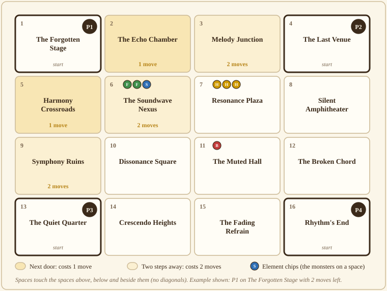
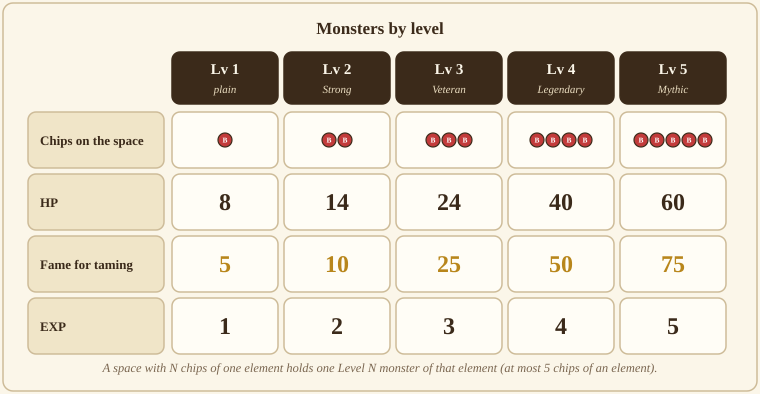

<!--
  PRINTING: each 
 is a page break. Print from any Markdown viewer that honours
  them (a browser "Print to PDF" works): US Letter or A4, portrait, margins about 15 mm,
  "background graphics" on. The last page is the quick reference.

  KEEP IN SYNC: numbers here (fame gate, monster table, dice prices, setup counts) are checked
  against the game's tunables by src/rulebook.test.ts, and the diagrams in img/ are generated by
  scripts/rulebook-visuals.ts, which also refreshes the style list in Appendix A. After a balance
  change run:  npx tsx scripts/rulebook-visuals.ts
  Keep the book short: say only what a player needs. Odd cases go in Appendix B.
-->

# The Rulebook

**For 2 to 4 bards** · *Tame the monsters. Win the crowd. Outshine the Silence.*

**Contents:** [1 Introduction](#1-introduction) · [2 Setup](#2-setup) · [3 Rounds](#3-rounds) · [4 Turns](#4-turns) · [5 Playing Songs](#5-playing-songs) · [6 The Studio](#6-the-studio) · [7 Monster Rules](#7-monster-rules) · [8 Fame](#8-fame) · [9 The Final Showdown](#9-the-final-showdown) · [10 Scoring](#10-scoring) · [A Styles](#appendix-a-the-styles) · [B Edge Cases](#appendix-b-edge-cases) · [C Quick Reference](#appendix-c-quick-reference)

## 1. Introduction

The Silence swallowed the world's music, and in the quiet, monsters woke. You are a **Bard**: you travel a ruined realm, play songs to tame monsters, and win **Fame**. You spend **EXP** in the **Studio** on better dice and new styles. When one bard is famous enough, the Eternal Silence rises and every bard gets three verses to outshine it.

**The bard with the most Fame after the Final Showdown wins** and is crowned *Legend of the Realm*.

| | |
|---|---|
| **Roam** | Move across a 16-space realm to find monsters. |
| **Play** | Roll song dice to tame them for Fame and EXP. |
| **Grow** | Spend EXP in the Studio on dice and styles. |
| **Perform** | At 200 Fame the finale begins. |

You need a 16-space board, element chips in four elements (**Ballad** red, **Folk** green, **Hymn** yellow, **Shanty** blue), d4/d8/d12/d20 dice tinted by element, a mat with 6 song slots per bard, Fame/EXP/Inspiration counters, and 20 style cards. The Lute Hero app does all the counting for you, hot-seat or online.

## 2. Setup

1. **Pick an element.** Each bard picks a different one: your **starter element**.
2. **Start on a corner.** Bards 1 to 4 start on The Forgotten Stage, The Last Venue, The Quiet Quarter and Rhythm's End. Spaces touch the spaces above, below and beside them (no diagonals). Bards may share a space.
3. **Take your mat.** Put a **d8** of your starter element in **Song 1**. Songs 2 to 6 are empty. Start with **1 Inspiration**, 0 Fame and 0 EXP.
4. **Deal the board.** Put **one chip on each of the 16 spaces**: exactly four of each element, shuffled. Then swap chips until your start space holds a chip of **your own element**.
5. **Stock the Studio.** Shuffle a bag of **6 element chips of each element for every bard**. Draw **4 chips** face up (the **element shelf**). Turn **2** style cards face up (the **style shelf**).

Every chip is a **Level 1 monster** of its element. Bard 1 goes first, then seat order.

## 3. Rounds

Each round, every bard takes one [turn](#4-turns) in seat order. Then the round ends:

1. **Reinforcements.** Every bard adds one chip of **each element**, placed one per space at random (no space takes a second new chip until all have one). A space never holds more than **5 chips of the same element**.
2. **Monsters reset.** Monsters are rebuilt from their chips, so damage is healed.
3. **Refill** the element shelf to **4 chips**.

Reinforcements are the main way the board grows, so monsters get tougher the longer the game runs.

**The fame gate.** When **any** bard reaches **200 Fame**, finish the round, play **one more full round** (no reinforcements at its end), then begin the [Final Showdown](#9-the-final-showdown).

## 4. Turns

You choose how much of this to do:

### 1. Move: up to 2 spaces

Step to a neighbouring space, up to **2** times, so any space within two steps is open. Entering a space resets its monsters to full health. Before you fight, you may take back your last step.

### 2. Fight: once per turn

Fight the monsters on your space. See [Playing Songs](#5-playing-songs).

### 3. Visit the Studio

Any time except mid-fight. See [The Studio](#6-the-studio).

### 4. End your turn

Unspent EXP and Inspiration are kept.

> **Example.** Ana (Ballad) steps twice, fights a Level 2 Folk monster and tames it: 10 Fame, 2 EXP. In the Studio she spends 2 EXP and a Ballad chip to upgrade her d8 to a d12, then ends her turn.

## 5. Playing Songs

Your **setlist** is six songs, **each holding one die**. In a fight, **all** the monsters on your space are in play, and each song hits **one** of them.

**Play a song:** pick a target, roll that song's die, work out the damage, subtract it from the target's HP.

**Damage = (roll + crit rolls + bonuses) × element, rounded down.**

- **Crit.** A die showing its **highest face** crits: roll it again and add the result. Another top face rolls again, up to 10 extra rolls.
- **Bonuses.** "Adds +N to the **value of the song**" is added on top and **can't crit**. "Increases the **face value of a die**" changes the face itself, so the die **can crit**.
- **Element.** A monster is **weak** to its own element (×2) and **immune** to the opposite (×0). Ballad and Shanty are opposites, as are Folk and Hymn. Other pairings deal ×1.

**Tamed or wounded.**
- **0 HP: tamed.** You earn its Fame, and the die **comes back** (you may play that song again).
- **Hurt but standing: wounded.** The song is **spent** for the rest of the fight. Once you wound a monster, you stay **locked on** to it until it is tamed or you retreat.

**Reroll.** After a song wounds, pay **1 Inspiration** to reroll it. The new roll **replaces** the old one, even if worse.

**Featured songs.** If other bards share your space, borrow **one song from each** once per fight. Roll it plain (no styles, no rerolls); it isn't spent. If it tames a monster, the guest takes **half the Fame and EXP, rounded down**.

**Ending a fight.** Retreat any time, or fight until every monster is tamed or you run out of songs. You earn **Fame for each monster tamed** and **EXP for each monster wounded** (after a full victory that is every monster).

| Outcome | Result |
|---|---|
| **Every monster tamed** | The space is cleared: remove its chips, gain **1 Inspiration**, and place **one chip of an element you choose on each neighbouring space**. |
| **You retreat** | Chips of tamed monsters are removed (one per level). The rest stay, at full health. |

Monsters never hurt you. A fight costs only time and songs.

## 6. The Studio

Two shared shelves are open to all: **4 element chips** and **2 styles**. **EXP** (from wounding and taming) buys dice and styles. **Inspiration** (start with 1; +1 for clearing a space) pays for rerolls and shelf refreshes.

| Action | Cost | What happens |
|---|---|---|
| **Buy a new d4** | 1 EXP | Take any shelf chip. A d4 of that element goes in an empty song (see [Appendix B](#appendix-b-edge-cases) if all are full). |
| **Upgrade a die** | d8: 2 EXP, d12: 2 EXP, d20: 4 EXP | Also spend a shelf chip of **the die's element**. The die moves one step up. |
| **Buy Inspiration** | 1 EXP each | The price never rises. |
| **Learn a style** | Price on the card | You hold **2** styles at most; to learn a third, forget one. |
| **Refresh the shelves** | 1 Inspiration | Discard all shelf chips and styles and draw new ones. |

A **style** changes how **all** your songs play. The shelf refills at the start of each turn. Every style is in [Appendix A](#appendix-a-the-styles).

> **Example.** Ben has 3 EXP. He spends 2 EXP and a Ballad chip to upgrade his Ballad d8 to a d12, then 1 EXP and a Shanty chip on a Shanty d4 for his empty Song 2.

## 7. Monster Rules

A space with **N chips of one element** holds **one Level N monster** of that element. Three Folk chips and one Hymn chip make a Level 3 Folk and a Level 1 Hymn, both in your fight. No space holds more than **5 chips of the same element**, so the top level is 5.

| Level | Name prefix | HP | Fame for taming | EXP |
|---|---|---|---|---|
| 1 | (none) | 8 | 5 | 1 |
| 2 | Strong | 14 | 10 | 2 |
| 3 | Veteran | 24 | 25 | 3 |
| 4 | Legendary | 40 | 50 | 4 |
| 5 | Mythic | 60 | 75 | 5 |

Monsters return to **full health** when a space is entered and at every round end. Their **level** changes only with chips: taming or retreating removes chips, reinforcements and clearing a neighbour add them.

## 8. Fame

**Fame** is your score.

| Source | Fame |
|---|---|
| **Taming a monster** | **5, 10, 25, 50, 75** for Levels 1 to 5 |
| **Styles** | Some add Fame (Crowd Favorite) |
| **The Final Showdown** | Your **fandom** is added when the show ends |

A Level 5 monster is worth fifteen Level 1s, but has 60 HP and you fight once a turn. Reaching **200 Fame** starts the countdown described in [Rounds](#3-rounds). You do not need to reach it first to win: the Showdown counts too.

## 9. The Final Showdown

The **Eternal Silence** has no HP. You earn **fandom**, the damage your performance deals. There are **three verses**; in each, every bard performs once in seat order:

1. **Pick one element.** **Every die** of it in your setlist is part of the performance.
2. **Roll them all together.** Total them like a fight (rolls, crits, bonuses, multiplier). That total is your fandom this verse.
3. **Reroll if you like:** **1 Inspiration** rerolls the whole performance, replacing the old roll.

The Silence has **no weakness**, so songs deal ×1. After each verse it becomes **immune (×0) to the element of the strongest performance**, for the next verse only. Save Inspiration for the finale; it is worth nothing once the game ends.

## 10. Scoring

**Final Fame = board Fame + Showdown fandom.** The most Fame wins. A tie goes to the bard with more **Showdown fandom**; everyone else is ranked in the same order. A Tour Summary hands out light-hearted awards but never changes the winner.

> **Example.** Ava: 214 Fame + 61 fandom = 275. Ben: 201 + 84 = 285. Cam: 188 + 70 = 258. **Ben wins**, though Ava led on the board.

## Appendix A: The Styles

Prices are in EXP. Same list, with simulated strength, on the game's **Songbook** page (`/songbook`). "Adds +N to the value of the song" never changes a die's face (can't crit). "Increases the face value of a die" does (can crit).

<!-- STYLES:START -->
| Style | EXP | What it does |
|---|---|---|
| **Rallying Cry** | 2 | Once per turn, after a song tames a monster, refresh any spent song. |
| **Extra Verse** | 1 | Gain a 7th song slot. |
| **War Drums** | 2 | All your dice crit one number lower. Bonus dice still need the top face. |
| **Nimble Fingers** | 1 | Once per turn, re-roll the die you just rolled and keep the higher result. |
| **Master's Touch** | 2 | Once per turn, roll your first d4, d8 or d12 die twice and keep the higher. |
| **Dragon's Roar** | 2 | Increases the face value of every d20 by 2. Reaching 20 crits. |
| **Lingering Note** | 3 | Once per turn, a d20 song that fails to tame isn't spent. Costs 1 Inspiration. |
| **Dissonance** | 2 | Once per turn, a roll against an immune monster deals full damage. |
| **Harmony** | 2 | With all four elements in your setlist, adds +1 to the value of the song per die. Can't crit. |
| **Fanfare** | 2 | Adds +3 to the value of your first song each turn. Can't crit. |
| **Crowd Favorite** | 3 | +10 Fame for every Lv3+ monster you tame. |
| **Muse's Favor** | 1 | Gain 1 Inspiration at the start of each turn. |
| **Hometown Hero** | 1 | Increases the face value of your starting element's dice by 1. Reaching the crit face crits. |
| **Studio Regular** | 3 | Upgrades cost 1 less EXP. |
| **Inspired Play** | 3 | With 3+ Inspiration, adds +2 to the value of the song per die. Can't crit. |
| **Steady Hands** | 1 | Increases the face value of any die below 3 to 3. The raised face can crit. |
| **Street Performer** | 1 | Gain 1 EXP at the start of each turn. |
| **Chain Reaction** | 2 | Adds +2 to the value of the song per die, for each same-element song played just before it (max +6). Can't crit. |
| **Swarm Singer** | 2 | In fights with 3+ monsters, adds +1 to the value of the song per die. Can't crit. |
| **Jam Session** | 3 | While sharing a space with another bard, adds +2 to the value of the song per die. Can't crit. |
<!-- STYLES:END -->

## Appendix B: Edge Cases

- **Reroll.** The new roll always replaces the old one, even if worse. (Nimble Fingers keeps the higher.)
- **Locked on.** A wounded monster stays your target until tamed or you retreat. If it is immune to everything you have, retreat.
- **Retreat before any song** is allowed. You earn nothing.
- **Spent songs** come back at the start of your next fight; tamed songs come back at once.
- **Passing through a space** resets its monsters just like stopping there.
- **Crowded neighbours.** When you clear a space, skip any neighbour that already holds 5 chips of the element you chose. Reinforcement chips that do not fit go to another space.
- **Full setlist.** A new d4 replaces a die of your choice.
- **No chip, no upgrade.** An upgrade needs a shelf chip of the die's element. If none is there, refresh the shelf (1 Inspiration) or wait for the next refill.
- **Third style.** Choose one you hold to forget.
- **Featured songs** can't be rerolled and are never spent. Online, the guest must agree.
- **Several bards at the gate.** Still just one extra round, with no reinforcements at its end.
- **Showdown immunity** needs at least two performances to compare. If the strongest are tied, the earlier performer's element counts.
- **Tied Fame** is broken by Showdown fandom.
- **Rounding.** Damage rounds down. A song of an immune element deals zero.

## Appendix C: Quick Reference

**A turn.** **Move** up to **2** spaces (entering resets monsters) · **Fight** once · **Studio** any time but mid-fight · **End**: unspent EXP and Inspiration are kept.

**A fight.** One monster per song. **Damage = (roll + crits + bonuses) × element, rounded down.** Tamed: Fame, die returns. Wounded: song spent and you are locked on; reroll for 1 Inspiration. Clear the space: +1 Inspiration and add a chip to each neighbour. Retreat any time.

| Your song ↓ / monster → | Ballad | Folk | Hymn | Shanty |
|---|---|---|---|---|
| **Ballad** | ×2 | ×1 | ×1 | ×0 |
| **Folk** | ×1 | ×2 | ×0 | ×1 |
| **Hymn** | ×1 | ×0 | ×2 | ×1 |
| **Shanty** | ×0 | ×1 | ×1 | ×2 |

| Level | HP | Fame | EXP |
|---|---|---|---|
| 1 | 8 | 5 | 1 |
| 2 | 14 | 10 | 2 |
| 3 | 24 | 25 | 3 |
| 4 | 40 | 50 | 4 |
| 5 | 60 | 75 | 5 |

| Costs | |
|---|---|
| New d4 · d4 to d8 · d8 to d12 · d12 to d20 | 1 · 2 · 2 · 4 EXP (upgrades also use a matching shelf chip) |
| Inspiration | 1 EXP |
| Reroll · refresh the shelves | 1 Inspiration |

**Limits.** 6 songs, 2 styles, 5 chips of one element per space. **Round end:** each bard adds one chip of every element. **Gate:** 200 Fame, then one more round, then the Showdown. **Showdown:** 3 verses, one element per performance, the Silence becomes immune to the strongest element. **Win:** most Fame (board + fandom); ties go to fandom.
