<!--
  PRINTING: this file is laid out as a rulebook. Each 
 is a page break.
  Print it from any Markdown viewer that honours them (a browser "Print to PDF" works),
  with the page set to US Letter or A4, portrait, margins about 15 mm, "background graphics" on.

  KEEP IN SYNC: numbers here (fame gate, monster table, dice prices, setup counts) are checked
  against the game's tunables by src/rulebook.test.ts, and the diagrams in img/ are generated by
  scripts/rulebook-visuals.ts, which also refreshes the style list in Appendix A. After a balance
  change run:  npx tsx scripts/rulebook-visuals.ts
-->

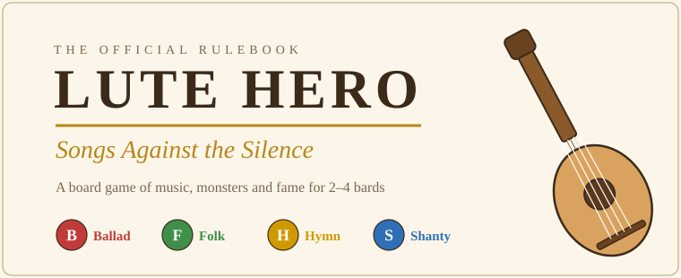

# The Rulebook

**For 2 to 4 bards**

*Tame the monsters. Win the crowd. Outshine the Silence.*

## Contents

| | Section | |
|---|---|---|
| 1 | [Introduction](#1-introduction) | What the game is, and how you win |
| 2 | [Setup](#2-setup) | Getting the table ready |
| 3 | [Rounds](#3-rounds) | How the game keeps time |
| 4 | [Turns](#4-turns) | What you do on your turn |
| 5 | [Playing Songs](#5-playing-songs) | Fights, dice and damage |
| 6 | [The Studio](#6-the-studio) | Spending EXP and Inspiration |
| 7 | [Monster Rules](#7-monster-rules) | Chips, levels and elements |
| 8 | [Fame](#8-fame) | Earning it, and the gate to the finale |
| 9 | [The Final Showdown](#9-the-final-showdown) | Three verses against the Silence |
| 10 | [Scoring](#10-scoring) | Who is crowned Legend of the Realm |
| A | [The Styles](#appendix-a-the-styles) | Every style you can learn |
| B | [Quick Reference](#appendix-b-quick-reference) | One page to keep beside the board |
| C | [Glossary](#appendix-c-glossary) | Every term, briefly |

> **How to read these rules.** Rules are in plain type. A **Remember** box repeats a rule that is easy to forget. An **Example** box walks through a real situation. Numbers in this book are the game's default numbers.

## 1. Introduction

The Silence came and swallowed the world's music. Cities fell quiet, and in the quiet, monsters woke. Only the **Bards** remain: wanderers with a lute, a handful of dice and a stubborn belief that a good song can tame anything.

In **Lute Hero** you are one of those Bards. You travel a ruined realm, play songs to tame the monsters you meet, and win their **Fame**. You spend what you earn in the **Studio** on stronger dice and new playing styles. When one bard has become famous enough, the Eternal Silence itself rises, and every bard gets three verses to outshine it.

### How you win

**The bard with the most Fame at the end of the Final Showdown wins** and is crowned *Legend of the Realm*. You earn Fame by taming monsters on the board, then add the crowd you win in the Showdown.

### The game in four beats

| | | |
|---|---|---|
| **Roam** | Move across a 16-space realm to find monsters worth your songs. | [Turns](#4-turns) |
| **Play** | Roll your song dice to tame them. Tame one and its Fame and EXP are yours. | [Playing Songs](#5-playing-songs) |
| **Grow** | Spend EXP in the Studio to upgrade dice and learn styles. | [The Studio](#6-the-studio) |
| **Perform** | When Fame reaches the gate, the finale begins. | [The Final Showdown](#9-the-final-showdown) |

### What you need

| Component | Count | Used for |
|---|---|---|
| Board | 1 board of 16 spaces in a 4×4 grid | The realm you roam |
| Element chips | 4 elements: **Ballad**, **Folk**, **Hymn**, **Shanty** | Monsters on the board, and the Studio shelf |
| Dice | d4, d8, d12 and d20, tinted by element | Your songs |
| Bard mat | 1 per bard, with 6 song slots | Your setlist |
| Counters | Fame, EXP and Inspiration, per bard | Your score and your spending money |
| Style cards | 20 different styles | Ways to play, learned in the Studio |

> **Playing on a screen.** The Lute Hero app handles all the counting for you: the chips, the monsters and the dice. It plays two ways: hot-seat on one device, or online with a join code. These rules describe the game as you would play it at a table.

## 2. Setup

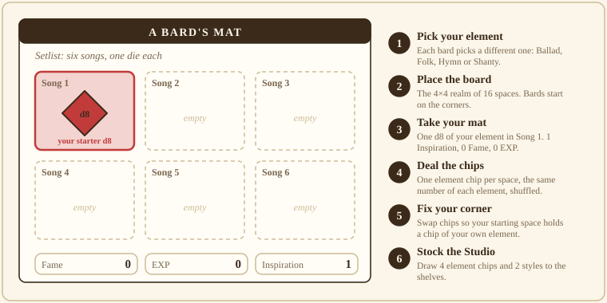

1. **Pick your element.** Each bard picks a different one. Your element is your **starter element**: it decides the colour of your first die and which monsters your first songs favour. The four elements are **Ballad** (red), **Folk** (green), **Hymn** (yellow) and **Shanty** (blue).
2. **Place the board.** Lay out the 16-space realm (the [map](#the-realm-board) is below). Bards start on the corners: Bard 1 on The Forgotten Stage, Bard 2 on The Last Venue, Bard 3 on The Quiet Quarter and Bard 4 on Rhythm's End.
3. **Take your mat.** Put one **d8** of your starter element in **Song 1**. Songs 2 to 6 start empty. Start with **1 Inspiration**, 0 Fame and 0 EXP.
4. **Deal the opening chips.** Put **one element chip on each of the 16 spaces**. Use exactly four of each element, shuffled, so no element is favoured.
5. **Fix your corner.** Swap chips around until the space you start on holds a chip of **your own element**. Keep four of each element on the board.
6. **Stock the Studio.** Make a bag with **6 element chips of each element for every bard** (so 48 chips for two bards, 96 for four) and shuffle it. Draw **4 chips** face-up to the **element shelf**. Shuffle the style cards and turn **2** face-up to the **style shelf**.

Every chip starts the game as a **Level 1 monster** of its element. Bard 1 takes the first turn, then play passes in seat order.

### The realm board

Each space touches the spaces above, below and beside it. There are no diagonal moves. Any number of bards may stand on the same space.

> **Remember.** The element of the chip on a space is the element of the monster that lives there. A monster is weak to songs of its own element, so your starter element is already good for the monster on your doorstep.

## 3. Rounds

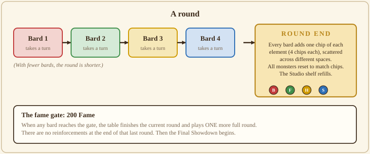

The game is played in **rounds**. In each round, every bard takes one [turn](#4-turns), in seat order. When the last bard has finished, the round ends.

### Round end

When a round ends, do these things in order:

1. **Reinforcements.** Every bard adds one chip of **each of the four elements**. So each round puts **4 new chips per bard** onto the board. Shuffle the spaces and place the chips one to a space, so that no space takes a second new chip until every space has taken one. A space never holds more than **5 chips of the same element**; a chip that does not fit goes to another space.
2. **Monsters reset.** Every space's monsters are rebuilt from its chips (see [Monster Rules](#7-monster-rules)), so any damage a monster took is healed.
3. **Refill the shelf.** Top the Studio's element shelf back up to **4 chips**.
4. **Next round.** Move the round marker on. Bard 1 goes first again.

> **Remember.** Reinforcements are the **only** way the board grows, apart from bards radiating elements when they clear a space. The longer a game runs, the tougher the monsters become, because chips pile up.

### The fame gate

When **any** bard reaches **200 Fame**, the table finishes the round in progress and then plays **one more full round**. That last round gets **no reinforcements** at its end. Then the [Final Showdown](#9-the-final-showdown) begins. Everyone gets that last round, so the leader can be caught.

## 4. Turns

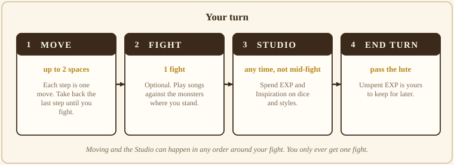

On your turn you may do the following. You choose how much of it to use.

### 1. Move: up to 2 spaces

Move to a space beside yours. That is **one move**. You may make **up to 2 moves** each turn, so every space within two steps is open to you (the board picture on the previous pages shows the range).

- You may stop after one move, or not move at all.
- **Entering a space resets its monsters** to match its chips, which heals any that were wounded. You do this to each space you step into, including one you only pass through.
- Until you start a fight, you may **take back your last step**. That refunds the move.

### 2. Fight: once per turn

If there are monsters on your space, you may **fight** them. You get **one fight per turn**. The fight is explained in [Playing Songs](#5-playing-songs).

### 3. Visit the Studio

You may visit the [Studio](#6-the-studio) at any time on your turn, **except in the middle of a fight**. Most bards go after their fight, to spend what they just earned. You may go before your fight, or before or after you move.

### 4. End your turn

Pass play to the next bard. Your moves, your fight and any other once-a-turn effects reset for next time. **EXP and Inspiration you did not spend are yours to keep.**

> **Example.** Ana (Ballad) stands on her corner. She has 2 moves but the best monsters are two spaces away. She steps twice, fights a Level 2 Folk monster and tames it for 10 Fame and 2 EXP. In the Studio she spends 2 EXP to upgrade her d8 to a d12, then ends her turn.

## 5. Playing Songs

### Your setlist

Your **setlist** is your six songs. **Each song holds exactly one die.** You start with a single d8 in Song 1. Better dice and more of them come from the [Studio](#6-the-studio). A style called Extra Verse gives you a seventh song.

### Starting a fight

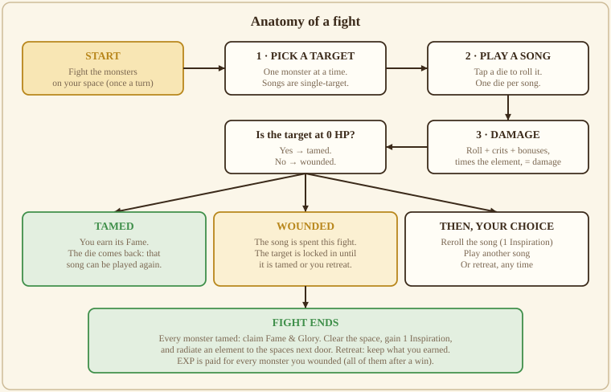

To start, say you are fighting the monsters on your space. **All** the monsters there are in the fight. Then:

1. **Pick a target.** Each song hits **one** monster; there are no area attacks.
2. **Play a song.** Roll its die.
3. **Work out the damage.** See below.
4. **Apply it.** Subtract the damage from the target's HP.

### Working out damage

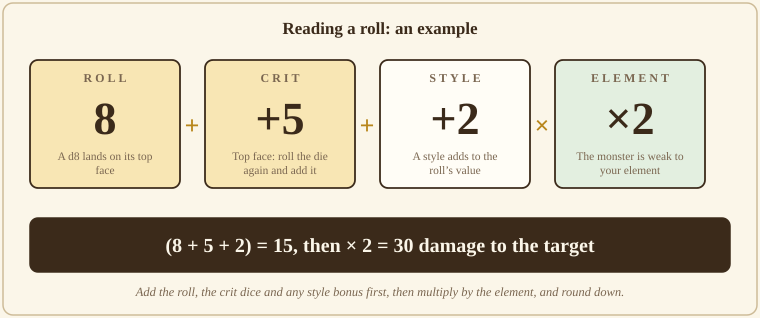

1. **The roll.** The number the die shows.
2. **Crits.** If the die shows its **highest face** (a 4 on a d4, an 8 on a d8, and so on), it **crits**: roll that same die again and **add** the result. If the new roll is also the highest face, roll again, and so on, up to 10 extra rolls.
3. **Bonuses.** Add any bonus a style gives you. A bonus like "+2" is added to the **value of the roll**. It does not change the face the die shows, so on its own it never causes a crit. (A few styles say otherwise on their card.)
4. **The element.** Multiply by how the monster feels about your element:

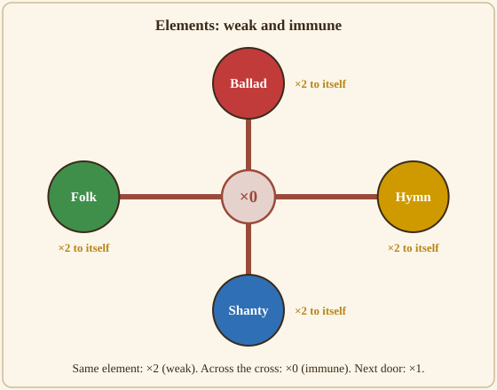

Round down. A song of an immune element does **zero** damage.

### Tamed or wounded

- **If the target is reduced to 0 HP, it is tamed.** You earn its **Fame**. The die **comes back**: that song is still ready, and you may play it again this fight, against any monster.
- **If the target is hurt but still standing, it is wounded.** The song is **spent** for the rest of this fight (turn the die on its side). A spent song comes back at the start of your next fight.

> **Remember.** Taming a monster *refreshes* the song that did it, so the best way to keep playing is to finish things.

### Locked on

Once you have **wounded** a monster, you must keep targeting it until it is tamed or you retreat. You cannot switch to a fresher monster.

### Rerolling

After a song that **wounded** (but did not tame), you may spend **1 Inspiration** to **reroll that song**. The new roll **replaces** the old one, even if it is worse. You may reroll again as long as you can pay. Some styles give you a free reroll.

### Featured songs

If other bards stand on your space, you may borrow **one song from each of them** per fight. Roll it as it is: **no styles, no rerolls**, and it is not spent afterwards. If a featured song tames a monster, the monster's **Fame and EXP are split**: your guest takes **half, rounded down**, and you keep the rest. Online, the guest must agree.

### Ending a fight

The fight ends when you **retreat** (you may at any moment, even before your first song), when you run out of songs to play, or when every monster is tamed.

| How it ends | What happens |
|---|---|
| **Every monster tamed** | **Claim Fame & Glory.** The space is cleared: remove all its chips. Gain **1 Inspiration**. Choose an element and place **one chip of it on each neighbouring space** (if it fits under the 5-chip limit). |
| **You retreat** | Chips of the monsters you tamed are removed (one per level); the chips of the survivors stay. The rest of the monsters come back at full health. |

**Rewards:** you earn **Fame** for each monster you **tamed**. You earn **EXP** for each monster you **wounded**, which after a full victory is *every* monster; after a retreat, only the ones you actually hurt.

> **Remember.** Monsters never hurt you. The cost of a fight is only your time and your songs.

## 6. The Studio

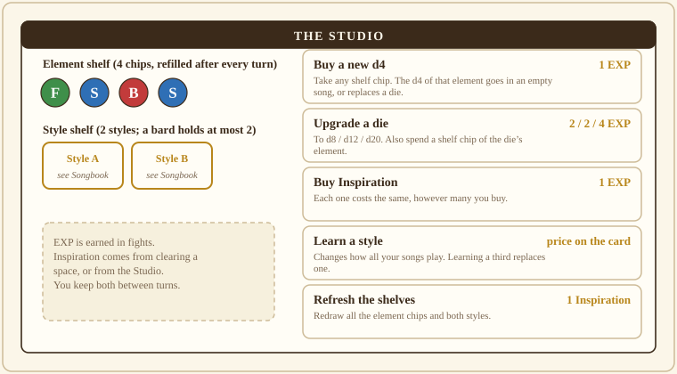

The Studio is where EXP and Inspiration become power. It has two shared shelves, visible to everyone: **4 element chips** and **2 styles**.

### Your two currencies

- **EXP** is earned by wounding and taming monsters. It buys dice and styles.
- **Inspiration** is gained by clearing a space (+1) or bought for EXP. It pays for rerolls and for refreshing the shelves. You start with 1.

### What you can do

| Action | Cost | What happens |
|---|---|---|
| **Buy a new d4** | 1 EXP | Take any chip from the element shelf. A d4 of that element goes in an **empty song**. If all your songs are full, it replaces a die of your choice. The chip is used up. |
| **Upgrade a die** | d8: 2 EXP, d12: 2 EXP, d20: 4 EXP | Also spend a shelf chip of the **same element as that die**. The die moves one step up the ladder. |
| **Buy Inspiration** | 1 EXP each | The price never rises, however many you buy. |
| **Learn a style** | The price on the card | See below. |
| **Refresh the shelves** | 1 Inspiration | Throw away all the shelf's chips and styles and draw new ones. |

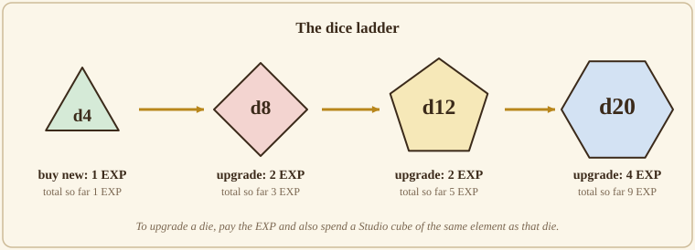

> **Remember.** Every upgrade needs a chip of the right colour. If the shelf has no chip of your die's element, you cannot upgrade it. You can refresh the shelf for 1 Inspiration, or wait for the next turn's refill.

### Styles

A **style** changes how **all** your songs play. You may hold **2** styles at a time. To learn a third, choose one you hold to forget. The style shelf shows 2 styles; when you buy one, its place is refilled at the start of the next turn. Each style's rule and price is in [Appendix A](#appendix-a-the-styles).

> **Example.** Ben has 3 EXP and 1 Inspiration. The shelf shows Hymn, Shanty, Folk and Ballad, and his d8 is a Ballad die. He spends 2 EXP and the Ballad chip to upgrade it to a d12. With 1 EXP left he buys a Shanty d4 for his empty Song 2, using the Shanty chip.

## 7. Monster Rules

### Chips make monsters

Every **chip** on a space stands for a monster. A space with **N chips of one element** holds **one Level N monster of that element**. So three Folk chips and one Hymn chip make a Level 3 Folk monster and a Level 1 Hymn monster, both fighting you together.

No space ever has more than **5 chips of one element**, so no monster is above Level 5.

### Levels

| Level | Name prefix | HP | Fame for taming | EXP |
|---|---|---|---|---|
| 1 | (none) | 8 | 5 | 1 |
| 2 | Strong | 14 | 10 | 2 |
| 3 | Veteran | 24 | 25 | 3 |
| 4 | Legendary | 40 | 50 | 4 |
| 5 | Mythic | 60 | 75 | 5 |

### Elements

A monster takes the element of its chips. It is **weak** to songs of its own element (**×2**) and **immune** to songs of the **opposite** element (**×0**). The opposites are **Ballad and Shanty**, and **Folk and Hymn**. Songs of the two other elements deal **×1**.

### When monsters change

Monsters **come back at full health** when their space is entered, and at the end of every round, so wounds never carry over. Their **level changes only with the chips**: taming or retreating removes chips and lowers it; reinforcements and radiating add chips and raise it.

## 8. Fame

**Fame** is your score. You earn it in these ways:

| Source | Fame |
|---|---|
| **Taming a monster** | By level: **5, 10, 25, 50, 75** (Levels 1 to 5) |
| **A featured song that tames** | The guest takes half the monster's Fame, rounded down; you keep the rest |
| **Styles** | Some styles add Fame (for example Crowd Favorite) |
| **The Final Showdown** | Each bard's **fandom** is added to their Fame when the show ends |

A single Level 5 monster is worth as much as fifteen Level 1 monsters, so the reward for taming bigger monsters is large. They are also much harder: a Level 5 monster has 60 HP, and you can only fight once per turn.

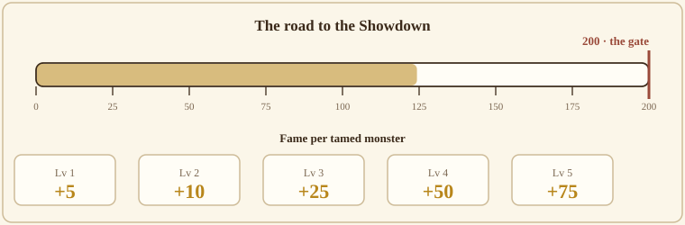

### The gate to the finale

The first time **any** bard's Fame reaches **200**, the game starts counting down: the table finishes the current round, plays one more full round (without reinforcements at its end), and the Final Showdown begins. See [Rounds](#3-rounds).

> **Remember.** You do not need to be the first to 200 to win. Fame earned in the Showdown counts too, so keep your Inspiration and a strong setlist.

## 9. The Final Showdown

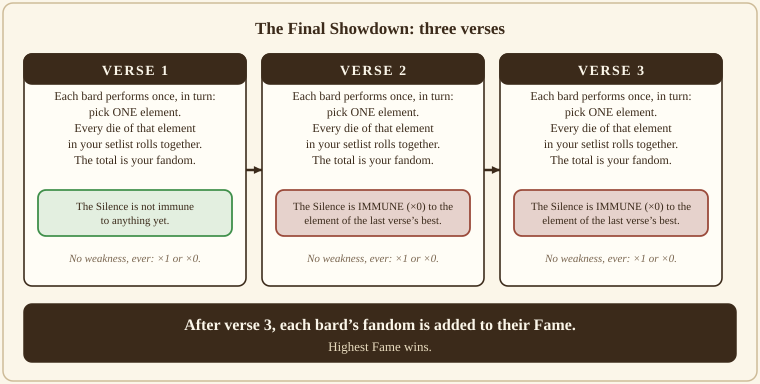

The **Eternal Silence** cannot be slain, only outshone. It has no HP. Instead, you earn **fandom**: the damage your performance deals to it. There are **three verses**.

### A verse

In each verse, every bard performs **once**, in seat order.

1. **Pick one element.** Choose a die from your setlist. Every die of that **same element** in your setlist is part of the performance.
2. **Roll them all together.** Work out the total just as in a fight: the rolls, crits and style bonuses, then the multiplier. That total is the fandom you earn this verse.
3. **Optionally reroll.** Spend **1 Inspiration** to reroll the whole performance. The new roll **replaces** the old one. Free-reroll styles work here too.
4. **End the performance** and pass to the next bard.

> **Remember.** One performance a verse, one element. If you own three Ballad dice and a Folk die, performing Ballad rolls all three Ballad dice and leaves the Folk die silent this verse.

### How the Silence fights back

- At the start, the Silence is **not immune** to anything. It has **no weakness, ever**: songs deal ×1, or ×0 if the Silence is immune to that element.
- After each verse, the Silence becomes **immune (×0)** to the element of that verse's **strongest** performance. This needs at least two performances to compare. If two are tied, the earlier performer's element counts.
- That immunity lasts for the **next** verse only.

Dice of an immune element deal zero damage (a style such as Dissonance can soften that), so play another element.

### Spend your Inspiration

Inspiration is worth nothing once the game ends, and each reroll can rescue a poor performance, so keep some in hand when the gate is near. After verse 3, each bard's total fandom is **added to their Fame**. Then see [Scoring](#10-scoring).

## 10. Scoring

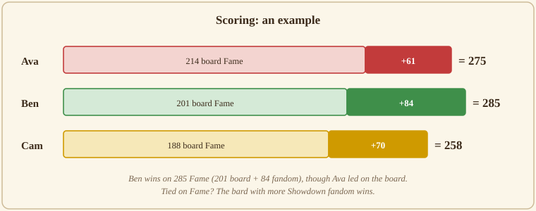

**Final Fame = the Fame you earned on the board + the fandom you won in the Showdown.**

- The bard with the **most Fame** wins and is crowned **Legend of the Realm**.
- If bards are **tied** on Fame, the bard with more **Showdown fandom** wins.
- Everyone else is ranked below in the same order.

> **Example.** Ava finishes the board with 214 Fame and wins 61 fans in the Showdown for 275. Ben has 201 Fame and wins 84 fans for 285. Cam has 188 and 70 for 258. **Ben wins**, though Ava led on the board: the finale decides it.

### The tour summary

The game ends with a **Tour Summary** that ranks every bard and hands out light-hearted awards, for example for the strongest hit or the most crits. They do not change the winner.

### Quick tips for new bards

- **Fight where you are strong.** Your starter element is strong against its own monsters. Tame those first.
- **Finish what you start.** A tamed monster refreshes your song; a wounded one locks you in.
- **Upgrade steadily.** Each step up the dice ladder pays about the same damage for the EXP, so there is no wrong first buy.
- **Keep an eye on the gate.** Whoever is close to 200 Fame starts the countdown. Make sure your setlist is ready before the show.
- **Save Inspiration.** It is a spare roll in a fight and a lifeline in the finale.

## Appendix A: The Styles

A style changes how **all** your songs play. You may hold 2. Prices are in EXP. A bonus like "+3" is added to the value of the roll, not to the die's face. The same list, with simulated strength, is on the game's **Songbook** page (`/songbook`).

<!-- STYLES:START -->
| Style | EXP | What it does |
|---|---|---|
| **Rallying Cry** | 2 | Once per turn, after one of your songs tames a monster, refresh a spent song of your choice. |
| **Extra Verse** | 1 | Gain a 7th song slot. |
| **War Drums** | 2 | All your dice crit one number lower (bonus dice still need the top face). |
| **Nimble Fingers** | 1 | Once per turn, you may re-roll the die you just rolled and keep the higher value. |
| **Master's Touch** | 2 | Once per turn, your first roll of a d4, d8 or d12 die is rolled twice; keep the higher. |
| **Dragon's Roar** | 2 | Adds +2 to the value of every d20 roll; a roll that reaches 20 this way crits. |
| **Lingering Note** | 3 | Once per turn, a d20 song that doesn't tame its target isn't spent, for 1 Inspiration. |
| **Dissonance** | 2 | Once per turn, a roll against an immune target deals full damage. |
| **Harmony** | 2 | If your setlist holds all four elements, adds +4 to the value of your first roll each turn. It changes the roll, not the die's face, so it can't crit. |
| **Fanfare** | 2 | Adds +3 to the value of your first roll each turn. It changes the roll, not the die's face, so it can't crit. |
| **Crowd Favorite** | 3 | +10 Fame for every Lv3+ monster you tame. |
| **Muse's Favor** | 1 | Gain 1 Inspiration at the start of each turn. |
| **Hometown Hero** | 1 | Adds +1 to the value of dice of your starting element; a roll boosted to its crit face crits. |
| **Studio Regular** | 3 | Upgrades cost 1 less EXP. |
| **Inspired Play** | 3 | While you hold 3+ Inspiration, adds +2 to the value of every roll. It changes the roll, not the die's face, so it can't crit. |
| **Steady Hands** | 1 | A die that lands below 3 counts as showing 3. |
| **Street Performer** | 1 | Gain 1 EXP at the start of each of your turns. |
| **Chain Reaction** | 2 | Adds +2 to a roll's value for each same-element song played in a row before it (max +6). It changes the roll, not the die's face, so it can't crit. |
| **Swarm Singer** | 2 | In fights with 3+ monsters, adds +1 to the value of every roll. It changes the roll, not the die's face, so it can't crit. |
| **Jam Session** | 3 | While you share a space with another bard, adds +2 to the value of every roll. It changes the roll, not the die's face, so it can't crit. |
<!-- STYLES:END -->

## Appendix B: Quick Reference

### A turn

**1. Move** up to **2** spaces (entering a space heals its monsters; take back your last step before you fight). **2. Fight** once, against all the monsters on your space. **3. Studio** any time you are not mid-fight. **4. End** your turn: unspent EXP and Inspiration are kept.

### A fight

| Step | Rule |
|---|---|
| Target | One monster per song. Once you wound one, you are locked on to it. |
| Damage | (roll + crit rolls + style bonuses) × element, rounded down |
| Tamed | Earn its Fame; the die comes back |
| Wounded | The song is spent this fight; you may reroll for 1 Inspiration |
| Retreat | Any time. EXP for the monsters you wounded; Fame for the ones you tamed |
| Clear the space | +1 Inspiration, and radiate an element to the neighbours |

### Elements

| Your song ↓ / monster → | Ballad | Folk | Hymn | Shanty |
|---|---|---|---|---|
| **Ballad** | ×2 | ×1 | ×1 | ×0 |
| **Folk** | ×1 | ×2 | ×0 | ×1 |
| **Hymn** | ×1 | ×0 | ×2 | ×1 |
| **Shanty** | ×0 | ×1 | ×1 | ×2 |

### Costs and limits

| Costs | |
|---|---|
| New d4 · d4 to d8 · d8 to d12 · d12 to d20 | 1 · 2 · 2 · 4 EXP |
| Inspiration | 1 EXP |
| Reroll, or refresh the shelves | 1 Inspiration |

**Limits:** gate 200 Fame, then one more full round, then the Showdown. Every round end, every bard adds one chip of each element. At most 5 chips of one element on a space, 2 styles and 6 songs per bard. Showdown: 3 verses, one element per performance, 1 Inspiration per reroll.

## Appendix C: Glossary

| Term | Meaning |
|---|---|
| **Bard** | A player. |
| **Chip** | An element token on a space. Chips make monsters. |
| **Crit** | A die showing its highest face. Roll it again and add the result. |
| **Element** | Ballad, Folk, Hymn or Shanty. |
| **EXP** | Experience. Earned by wounding monsters; spent on dice and styles. |
| **Fame** | Your score. |
| **Fandom** | The crowd you win in the Final Showdown. It is added to your Fame. |
| **Featured song** | A song borrowed from another bard on your space. |
| **Gate** | 200 Fame. Reaching it starts the countdown to the Showdown. |
| **Inspiration** | A resource that buys rerolls and shelf refreshes. |
| **Round** | One turn for every bard, then the round end. |
| **Setlist** | Your six songs. |
| **Song** | One die in a slot on your mat. |
| **Spent** | A song that wounded without taming; it rests until your next fight. |
| **Studio** | Where you spend EXP and Inspiration. |
| **Style** | A card that changes how all your songs play. |
| **Tamed** | A monster reduced to 0 HP. |
| **The Silence** | The final boss. It has no HP and no weakness. |
| **Wounded** | A monster that is hurt but not tamed. |
